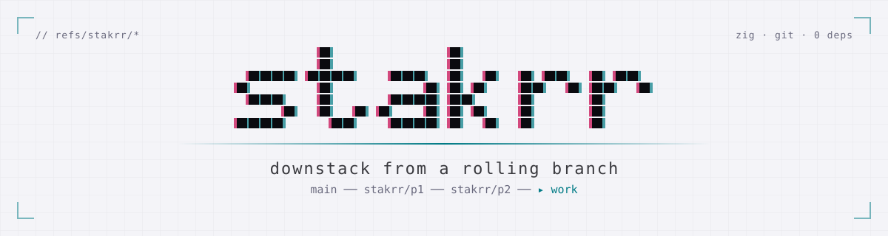
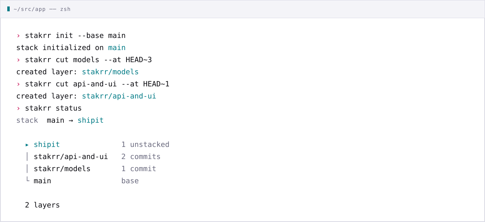

<p align="center">
  <picture>
    <source media="(prefers-color-scheme: dark)" srcset="assets/banner-dark.svg">
    
  </picture>
</p>

<p align="center">
  <a href="https://github.com/unworried/stakrr/actions/workflows/ci.yml"></a>
  <a href="https://github.com/unworried/stakrr/releases"></a>
  
  <a href="LICENSE"></a>
</p>

<p align="center"><code>keep committing at the top. carve reviewable layers out from underneath.</code></p>

<picture>
  <source media="(prefers-color-scheme: dark)" srcset="assets/session-dark.svg">
  
</picture>

## // why

stacked prs are great until you have to plan them up front. stakrr flips that:
work continuously on one rolling branch, then cut reviewable layers out from
underneath it as the boundaries become obvious, without hand-managing git
history each time.

- `gh stack` is slow, and i kept building stacks as an afterthought anyway
- a cut only creates a branch. no rebases, no rewritten commits
- ref updates use compare-and-swap: refused cuts leave refs unchanged, and
  interrupted publication can resume

## // install

grab a build from [releases](https://github.com/unworried/stakrr/releases),
verify it and put it on your `PATH`:

```sh
tag=v0.1.1             # choose a published tag from the releases page
target=aarch64-macos   # x86_64-macos · aarch64-linux-musl · x86_64-linux-musl
curl -fsSLO https://github.com/unworried/stakrr/releases/download/$tag/stakrr-$tag-$target.tar.gz
curl -fsSLO https://github.com/unworried/stakrr/releases/download/$tag/SHA256SUMS
shasum -a 256 -c --ignore-missing SHA256SUMS
tar -xzf stakrr-$tag-$target.tar.gz && mv stakrr ~/.local/bin/
```

or build from source with zig 0.17.0:

```sh
zig build -Doptimize=ReleaseSafe   # → zig-out/bin/stakrr
```

For zsh tab completion, add the repository's `completions` directory to your
`fpath` in `~/.zshrc`, before `compinit`:

```zsh
fpath=(/absolute/path/to/stakrr/completions $fpath)
autoload -Uz compinit
compinit
```

If your shell framework already runs `compinit`, put the `fpath` line before
loading the framework. Restart your shell after updating the configuration.

For Bash (3.2+), source the completion file in `~/.bashrc`:

```bash
source /absolute/path/to/stakrr/completions/stakrr.bash
```
Completion covers commands, flags, cut names for `go` and `fix`, local branches
for `init --base`, and refs for `cut --at`.

## // compatibility and limits

- `fix` requires Git 2.40 or newer for `merge-tree --merge-base`.
- Stack ref discovery requires Git's files ref storage (loose and packed refs).
  Reftable storage is unsupported for commands that discover stack refs.
- Base/work branches, layer branches and internal refs must be direct refs.
  Symbolic managed refs are rejected; HEAD itself may remain symbolic.
- `restack` requires a clean index and working tree, including untracked files.
  Replay uses a dedicated workspace; unrelated ignored build output may remain.
- Remote publication and restacking onto a moved base remain planned.

## // usage

```sh
git switch -c shipit             # the rolling branch, on top of main
stakrr init --base main

# ...commit as you go...

stakrr cut models --at HEAD~3    # oldest work becomes stakrr/models
stakrr cut api                   # everything since, up to the tip, becomes stakrr/api
stakrr status
```

## // fixing earlier cuts

To fold changes into a lower cut without leaving your rolling branch, stage them
and run `stakrr fix`:

```sh
git add model.zig
stakrr fix models -m "validate input"   # new commit on stakrr/models
stakrr fix models --amend               # or amend its last commit
stakrr fix -m "tidy"                    # the highest cut when none is named
```

Everything above the cut is replayed with in-memory merges, so unstaged edits and
the worktree are never touched, and the staged changes end up in history instead
of the index. If the change conflicts with the cut or a later commit, or replaying
it would not reproduce your index, nothing changes; use `stakrr go <cut>` to
resolve it by hand. Needs Git 2.40 or newer.

## // editing earlier cuts

Use ordinary Git on a cut. Switch to its branch, commit or amend, then `restack`
to replay everything above it:

```sh
stakrr go models                  # or: git switch stakrr/models
# edit files...
git add model.zig
git commit -m "fix validation"    # git commit --amend also works
stakrr restack                    # replay descendants; you stay where you are
```

Each cut records where it was last published in the ordered stack manifest.
A cut whose branch has moved past that record is *stale*: `stakrr status` marks
it, and `restack` replays the commits above its old boundary onto the new one,
including unstacked rolling work. Nothing happens until you restack, so you can
commit as many times as you like first. Only one cut may be stale at a time;
restack before changing another. `cut` and `fix` refuse while a cut is stale.

Empty commits stay present; upper-layer deletions stay deletions, with normal Git
conflicts if an edit changes a file deleted above it. A cut must keep at least one
linear commit above its previous boundary. Changing earlier boundaries or merging
branches inside an edit is unsupported.

`restack` requires a clean index and working tree, including untracked files. No
implicit commits or stashes are made. Replay runs in a dedicated locked worktree;
unrelated ignored files may remain in your checkout. `go`, `up` and `down` use
normal Git navigation and refuse to overwrite ignored files. While a restack is
pending, `init`, `cut`, `fix`, `reset`, `go`, `up` and `down` are blocked in every
worktree.

On a conflict, the restack stays pending and its state is saved:

```sh
stakrr status
cd <workspace-path-shown-by-stakrr>
# resolve conflicts, using git rm for a deletion if appropriate...
git add <resolved-files>
stakrr continue
```

`stakrr continue` works after restarting, from the original worktree or the replay
workspace. A manually committed resolution also works. Replay leaves the invoking
checkout untouched; final publication briefly detaches it, updates branches and the
manifest together, then returns it to its original branch. Hooks are disabled for
automated operations. Checkout collisions retain the replay result for continuation.
Only clean, verified workspaces are removed without force; unexpected files are
preserved and reported. Sparse checkout does not constrain replay, and submodules
are never automatically initialized or cleaned.

`stakrr abort` restores the stack from before the restack: every boundary and branch
goes back to its recorded position, including the commits you made on the stale cut.
Those commits stay reachable through the operation log (`stakrr log`). It requires
clean work: commit or otherwise preserve conflict resolutions and other uncommitted
changes first. It never runs `reset --hard` or discards files.

`stakrr log` lists checkpoints newest first, including an active session. Each
line gives an ISO 8601 timestamp, a readable step label, the before → after OIDs
of moved branches, and a rescue commit:

```sh
stakrr log
git branch rescue <commit-from-the-rescue-column>
```

Completed operation records remain reachable from `refs/stakrr/oplog`. Checkpoints keep
original boundaries and observed edit/replay commits reachable even after
`git gc --prune=now`. Retention is intentional and has no automatic expiry. Direct Git
commands in other processes do not take stakrr's lock; avoid concurrent manual
branch updates or worktree changes during an edit. Detected external changes
stop the operation and name the ref or HEAD that moved, with the commands to
keep it on a rescue branch and restore the expected value:

```sh
error: Git refs or HEAD changed outside the edit workflow; ...
hint: refs/heads/stakrr/api is at 9f8e7d6..., expected 1a2b3c4...
hint: keep it:    git branch rescue/stakrr/api 9f8e7d6...
hint: restore it: git update-ref refs/heads/stakrr/api 1a2b3c4... 9f8e7d6...
```

To keep the changed state instead, `stakrr quit` drops the pending restack like
`git rebase --quit`: HEAD, the index, files and branches stay as they are, and
HEAD plus the checkpoint are retained in `refs/stakrr/oplog` (inspect them with
`stakrr log`). Its workspace files and lock are preserved. It also works when the checkpoint is corrupt. Afterwards
`stakrr status` may need `stakrr reset`.

## // model

```
  ▸ shipit          ●  ●        unstacked, keep committing
  │
  │ stakrr/api      ●  ●  ●     layer 2
  │
  │ stakrr/models   ●           layer 1
  │
  └ main            ●           base, anchored at init
```

- `cut` creates a `stakrr/<name>` branch at a commit boundary on the rolling
  branch. the layer holds every commit between the previous boundary and its own
- it never changes `HEAD`, the index, working files or existing layer branches
- each cut must advance past the previous boundary and be reachable from the
  rolling branch
- if the base moves after `init` (`git pull` on main), cuts keep working relative
  to the original base commit and `status` warns. restacking onto the new base
  is planned

## // commands

|   | command | does |
| - | --- | --- |
| ● | `stakrr init --base <branch>` | adopt the current branch as rolling work on top of `<branch>` |
| ● | `stakrr cut <name> [--at <rev>]` | cut the next layer at `<rev>`, the tip by default |
| ● | `stakrr status` | draw the stack: layers, commit counts, unstacked work |
| ● | `stakrr reset [--delete-layers]` | forget the stack so it can be re-initialised |
| ● | `stakrr version` | print the version |
| ● | `stakrr fix [<cut>] -m <msg>\|--amend` | fold staged changes into a cut and replay what sits above it |
| ● | `stakrr go <cut>` | switch to a cut's branch to edit it with ordinary commits |
| ● | `stakrr up` / `stakrr down` | switch to the adjacent branch in the stack |
| ● | `stakrr restack` | replay what sits above a cut you committed on |
| ● | `stakrr continue` | resume a restack after a conflict |
| ● | `stakrr abort` | restore the stack from before a pending restack |
| ● | `stakrr log` | list edit checkpoints, branch moves and rescue commits |
| ● | `stakrr quit` | drop a pending restack, leaving HEAD and every branch as they are |
| ○ | `stakrr submit` | publish review branches, excluding rolling work |

<sub>● shipped · ○ planned for m2</sub>

Exit codes: 0 success, 1 failure, 2 usage, 3 replay conflict pending, 4 tree not
clean enough to proceed (dirty, ignored files, or a Git operation running), 5 refs
or HEAD changed outside stakrr.

## // internals

See [Git command flows](docs/git-flow.md) for each command's ordered checks,
Git mutations, publication transactions and recovery behavior.

| ref | holds |
| --- | --- |
| `refs/stakrr/state` | versioned `stack.json` commit with base/work, anchor and ordered layers; parents retain anchor/boundaries |
| `refs/heads/stakrr/*` | layer branches |
| `refs/stakrr/edit` | v1 active progress with workspace ownership, expected refs, replay and checkout phases |
| `refs/stakrr/oplog` | completed operation records and retained checkpoints |
| `refs/stakrr/transaction` | pending ref publication, retaining old/new values until recovery completes |
| `<git-common-dir>/stakrr.lock` | shared advisory mutation lock |

Completed records hold kind, before/after manifests, actual branch movements,
rescue objects and an explicit history link. Active checkpoints retain execution
progress separately. Commits are retained through parent links, with no expiry.

don't edit the internal refs by hand. a refused cut leaves every ref
unchanged. stakrr runs the `git` on your `PATH` and inherits the environment
(`GIT_DIR` and friends).

## // recovery

During a restack, inspect `stakrr status` and use `stakrr continue` after a
crash. Use `abort` to restore the stack from before the restack, or `quit` to
keep the current Git state and drop it. Preserve
uncommitted work first. `stakrr log` shows retained commits both during and after
a session; create a rescue branch from the listed commit before experimenting.

If Git is interrupted while publishing refs, stakrr retains the intended update.
`status` and `log` report it; run `stakrr continue` to finish. The next mutating
command also recovers it before proceeding. Recovery stops if a ref has an
unexpected value or a branch that still needs moving is occupied in another
worktree. Git lock files are preserved; remove a stale Git lock only after
checking that no Git process owns it, then retry.

Outside a managed edit, `status` renders available evidence even when branches are
missing or history is invalid. Mutations refuse inconsistent state. To start over,
preserve branches you need outside `stakrr/*`, then reset and reinitialize.

```sh
stakrr reset --delete-layers  # drop stack state and stakrr/* layer branches
stakrr init --base main
```

Use `stakrr reset` without `--delete-layers` to drop stack state while keeping
the layer branches. Those branches must be renamed or removed before `init`
can succeed.

`reset` never touches the rolling branch, `HEAD`, the index or the working
tree, and refuses to delete layers while one of them is checked out in any
worktree.

## // roadmap

```
m1  safe rolling stacks       ■■■■  init · cut · status · reset · go · up · down
m2  publishing + recovery     ■■■□  local editing + recovery shipped; submit planned
m3  base + stack maintenance  □□□□  update base · retire landed layers · replay remaining work
```

m1 is complete: cuts record boundaries without rewriting history.

m2 already includes `fix`, `restack`, conflict continuation, `abort`, `quit`,
the operation journal, `log` and interrupted ref publication recovery.
Remote publication with `submit` remains planned.

m3 will keep stacks current as upstream changes land:

- restack layers and rolling work onto an updated base; today's `restack` only
  replays descendants of an edited cut
- explicitly retire merged layers from stack tracking while preserving the
  remaining work
- support conflict continuation, journal checkpoints and abort for these
  operations using the existing recovery machinery

Later: extract hunks from existing commits into a lower layer, rewriting their
original commits too. `fix` already folds staged changes into a cut; moving
already-committed changes between layers remains a separate idea beyond m3.

## // principles

- don't rewrite history where it isn't required
- compare-and-swap every ref update
- create recovery points
- treat conflicts as resolvable failures, not hidden problems
- keep remote operations separate
- validate git worktrees

## // why zig?

you can only relax when the agents are sleeping. also, it's fast and i like
using it.

---

<sub>[changelog](CHANGELOG.md) · [contributing](CONTRIBUTING.md) · [mit](LICENSE)</sub>
